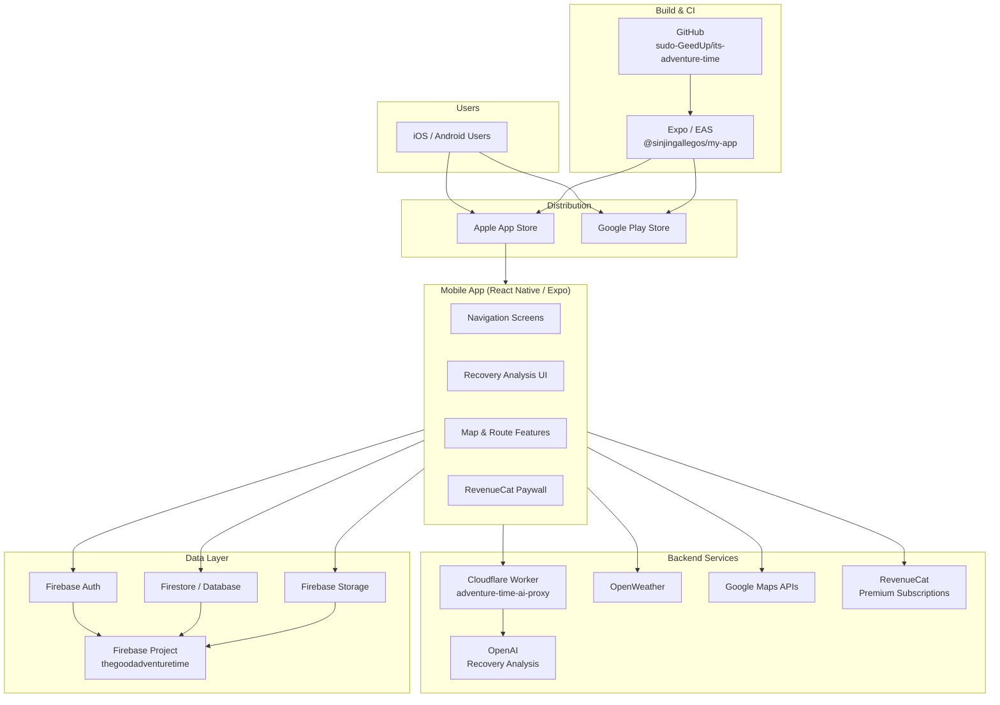

# Its Adventure Time - Business Map

Last Updated: Nov 17, 2026

## What This App Is

Its Adventure Time is an off-road recovery and navigation app built with Expo React Native.

**Features:**

- GPS tracking
- Navigation
- AI recovery assistance
- Offline guides
- Premium subscriptions
- Firebase backend

## Source Code

- **Local:** `~/its-adventure-time`
- **GitHub:** sudo-GeedUp/its-adventure-time
- **Status:** Verified Nov 17, 2026

## Architecture Map

## Build System

- **Expo Account:** sinjingallegos
- **Project:** @sinjingallegos/my-app
- **Project ID:** `02cac41b-21af-4ee7-bda0-26b4042a9013`
- **Purpose:** Builds iOS and Android apps
- **Recent Builds:** Version 3.0.1, Version 3.0.0, Version 2.1.1

## App Stores

- **Apple App Store:** Live
- **Google Play:** Android builds confirmed

## Backend

### Firebase

- **Project:** thegoodadventuretime
- **Services:** Authentication, Database, Storage

### Subscriptions

- **Provider:** RevenueCat
- **Status:** Configured

### AI

- **Provider:** OpenAI
- **Proxy:** adventure-time-ai-proxy
- **Hosted Through:** Cloudflare Workers

### Maps

- **Provider:** Google Maps
- **Status:** Configured

### Weather

- **Provider:** OpenWeather
- **Status:** Configured

## Development History

Important AI sessions:

- App Store Submission Fixes
- Debugging and Deploying Features
- Waze-like Map Features
- Implement Route-Aware Navigation
- Fix iOS Location Rejection
- Fixing Gitignore and Source Control

## Verified Nov 17, 2026

- [x] Local source code found
- [x] GitHub repository connected
- [x] Git history intact
- [x] Expo account access verified
- [x] Expo production builds verified
- [x] Firebase configuration located
- [x] RevenueCat configuration located
- [x] OpenWeather configuration located
- [x] Google Maps configuration located
- [x] AI Proxy configuration located

## Recovery Checklist

If rebuilding from scratch:

1. Clone GitHub repository
2. Login to Expo account
3. Restore environment variables
4. Login to Firebase
5. Login to RevenueCat
6. Verify Cloudflare Worker
7. Build through EAS
8. Submit through App Store Connect

## Notes

Originally built with assistance from AI tools including Windsurf and other coding assistants.
